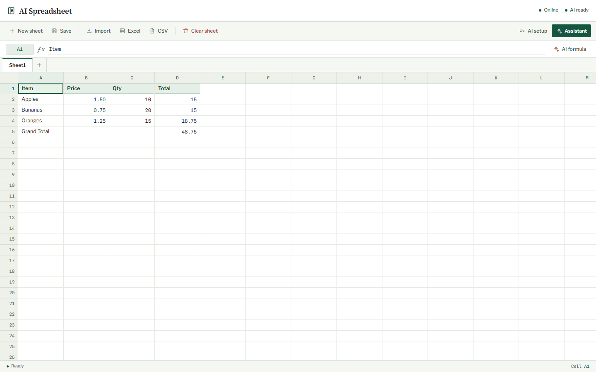
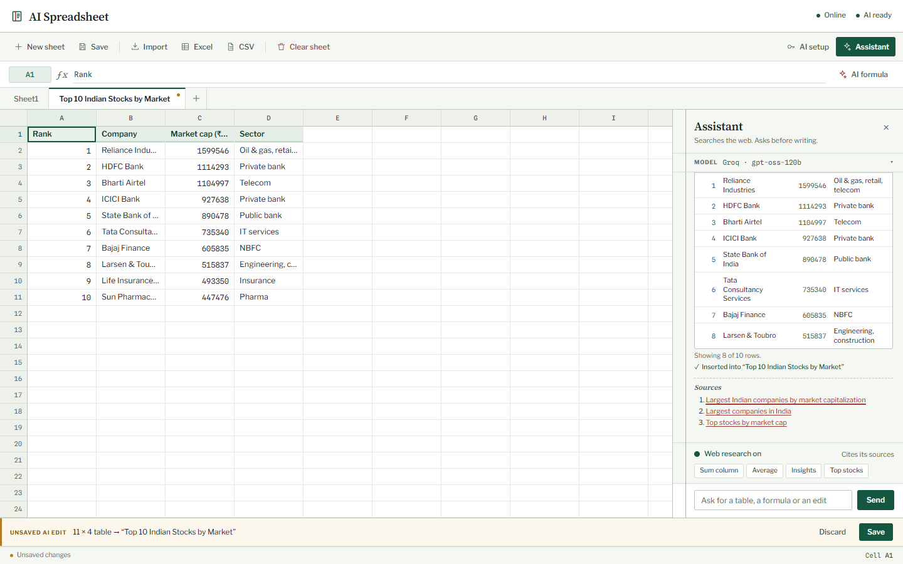
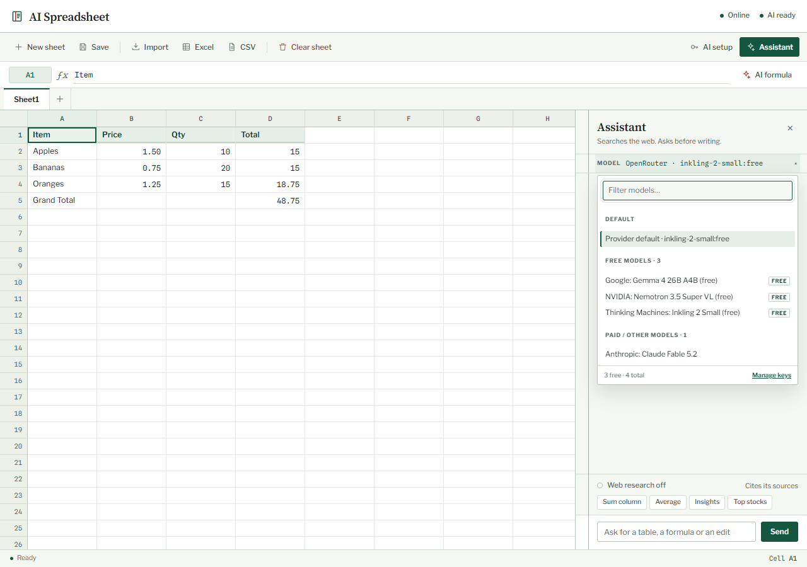
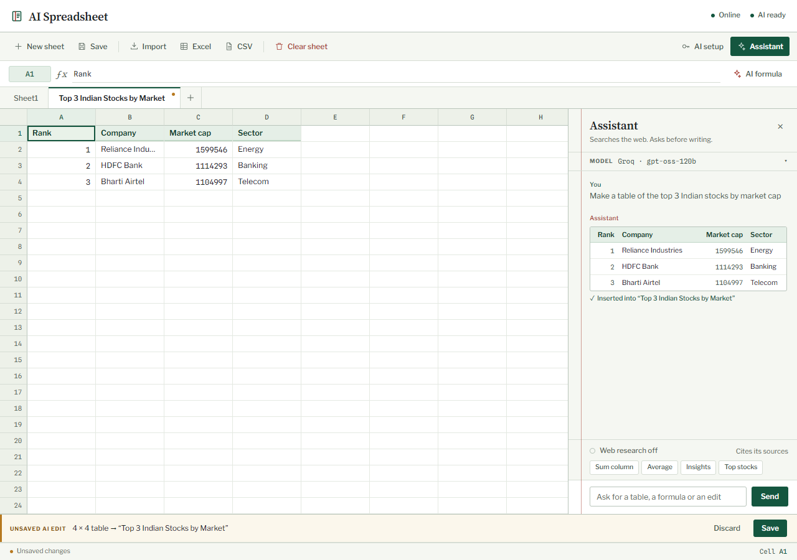
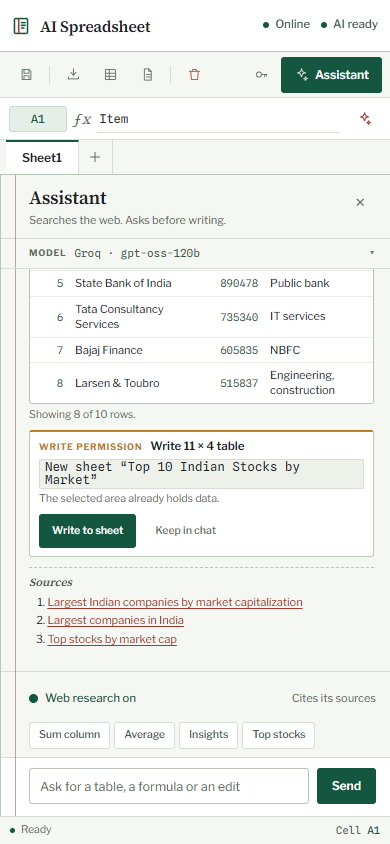
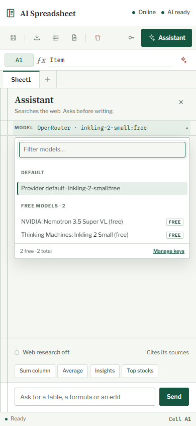
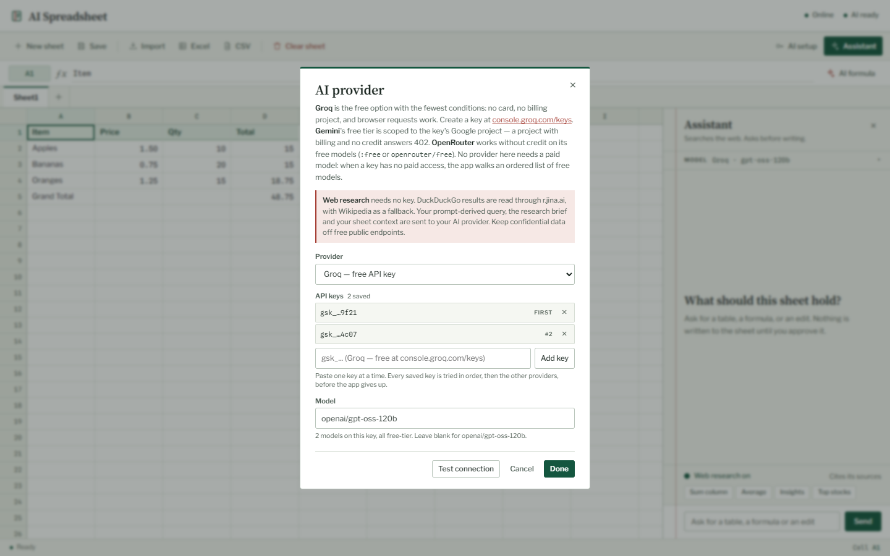
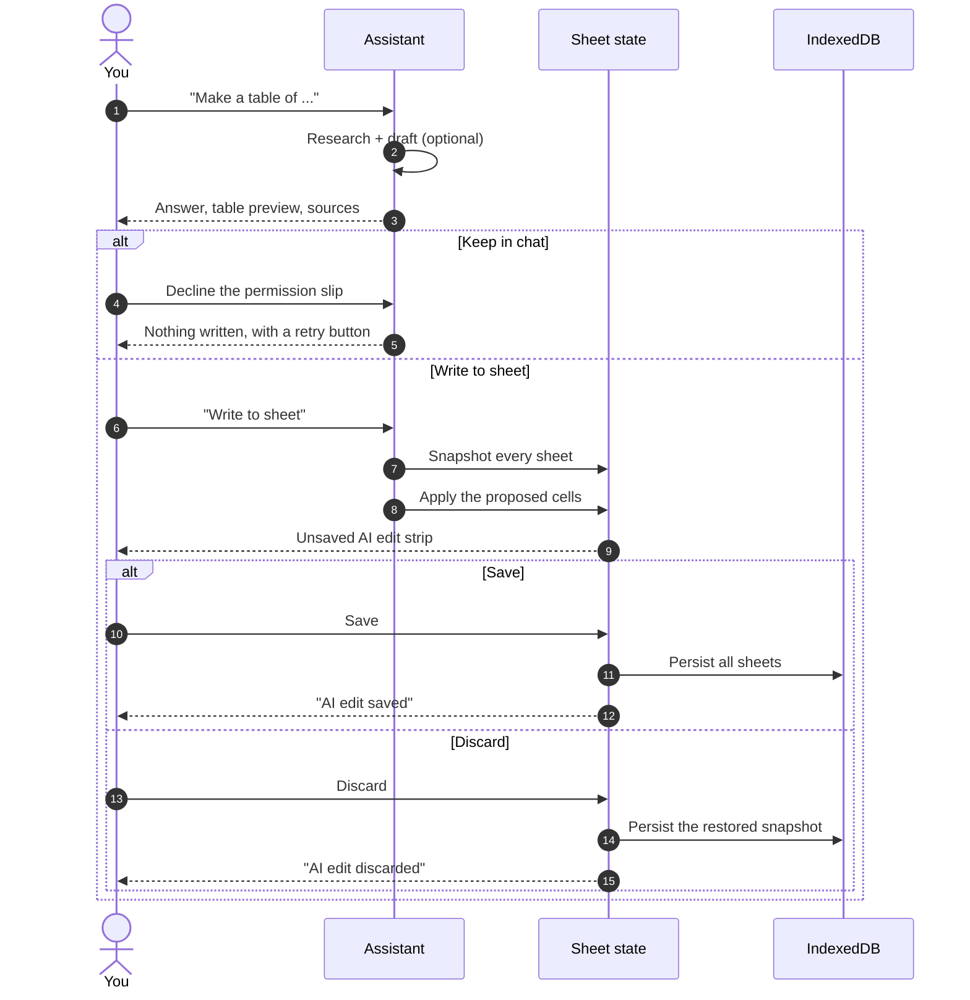
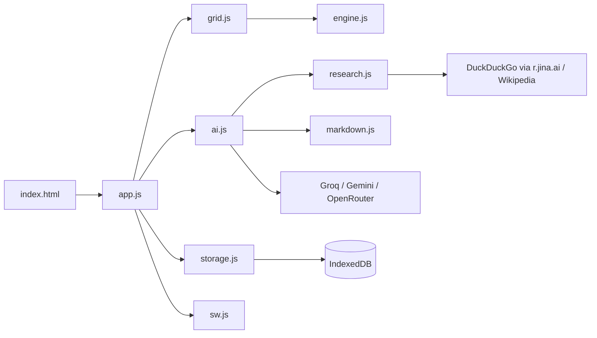

# AI Spreadsheet Assistant

An installable, offline-first spreadsheet that runs entirely in the browser. It has a real formula engine, multiple sheets, CSV/XLSX import and export, and an AI assistant that can research the live web before it proposes a table, a formula, or a cell edit.

The assistant never writes on its own. Every write asks for permission first, and every approved write lands in an **Unsaved AI edit** state with **Save** and **Discard** controls. Nothing is committed to the workbook until you say so.

Built from scratch with HTML, CSS, and ES modules. No framework, no build step, no backend, and no API keys in the repository.

- **Repository:** <https://github.com/Johnwick122005/AI-Spreadsheet-Assistant>
- **Runtime:** any modern browser; installable as a PWA on desktop and mobile
- **Data:** stored locally in IndexedDB
- **AI:** bring your own key for Groq, Google Gemini, or OpenRouter. Free models are tried first.

---

## Contents

- [Why this exists](#why-this-exists)
- [Screenshots](#screenshots)
- [Feature tour](#feature-tour)
- [Quick start](#quick-start)
- [Using the spreadsheet](#using-the-spreadsheet)
- [The assistant](#the-assistant)
- [AI providers and keys](#ai-providers-and-keys)
- [Choosing a model](#choosing-a-model)
- [The write lifecycle](#the-write-lifecycle)
- [Live web research](#live-web-research)
- [Formula reference](#formula-reference)
- [Import and export](#import-and-export)
- [Offline and PWA](#offline-and-pwa)
- [Architecture](#architecture)
- [Design](#design)
- [Limits and non-goals](#limits-and-non-goals)
- [Troubleshooting](#troubleshooting)
- [Privacy and security](#privacy-and-security)
- [Deployment](#deployment)
- [Development](#development)
- [QA checklist](#qa-checklist)
- [Credits](#credits)
- [License](#license)

---

## Why this exists

Most "AI spreadsheet" demos are a chat box bolted onto a grid. The model streams an answer, the answer is pasted into cells, and the user has no clean way to tell what changed, where it came from, or how to undo it.

This project treats the assistant as a careful collaborator:

1. **Research is visible.** When web research is on, the assistant reads live pages and cites its sources inline. You can inspect the links before trusting a number.
2. **Writes are proposals.** The assistant can display a table in the chat, but it cannot touch the sheet until you approve a permission slip.
3. **Approved writes are reviewable.** The workbook is snapshotted. A persistent strip shows the pending edit; **Save** persists it, **Discard** restores the exact previous state and removes any sheet the AI created.
4. **The sheet still behaves like a spreadsheet.** A1 references, ranges, formulas, recalculation, keyboard navigation, multiple sheets, and file import/export work independently of the AI.

The result is a small, self-contained spreadsheet app for research-heavy work: market tables, competitor lists, sourcing sheets, and quick calculations that need a citation trail rather than a confident guess.

---

## Screenshots

### The grid



A1 addressing, a formula bar, sheet tabs, and a working-paper palette. The seeded table demonstrates formulas: `Total` is `Price × Qty`, and `Grand Total` sums the column.

### Research with sources



The assistant searches the web, reads the top results, extracts tables where possible, and cites each source as `[1]`, `[2]`, and so on. A table in the chat is only a preview until you press **Insert into sheet** and approve the write.

### Model picker



Every provider has its own model list and its own saved choice. Free models are grouped first and tagged **FREE**; paid and other models stay available below them.

### Save or discard every AI write



The strip above the status bar names the pending edit. **Save** commits it to IndexedDB. **Discard** restores the snapshot taken immediately before the write, including removing a sheet that the AI created.

### Mobile

| Write permission | Model picker |
| --- | --- |
|  |  |

The sheet, assistant, permission slips, model menu, and review strip all fit a 390 px viewport. The assistant becomes an overlay on small screens instead of squeezing the grid.

### Provider setup



Keys are masked after they are added. Each provider keeps an ordered pool, and **Test connection** checks every saved key, not just the first one.

---

## Feature tour

### Spreadsheet

- 26 columns (A–Z) × 100 rows per sheet.
- Multiple named sheets, created from the toolbar or the `+` tab.
- A1 references, rectangular ranges such as `B2:B10`, and formulas that resolve against the active sheet.
- 20 built-in functions, arithmetic and comparison operators, string concatenation with `&`, and quoted string literals.
- Formula bar that updates the selected cell as you type.
- Double-click a cell to edit in place; `Enter` commits, `Escape` cancels.
- Arrow-key and `Tab` navigation; `Enter` moves down.
- Click the cell address to jump to any A1 address.
- Automatic recalculation of every formula on a sheet after any edit, so dependent totals never go stale.
- All sheets recalculated on load, so persisted formulas reflect the saved raw values.
- Dirty markers on sheet tabs and a status bar that reports unsaved changes.
- Explicit **Save** plus auto-save when the tab is hidden or closed.
- CSV import and export that work without any network connection.
- XLSX import and export through SheetJS, with the library cached for offline use after the first successful load.

### Assistant

- Chat interface docked in the right margin on desktop, full-height overlay on mobile.
- Live web research on by default, with an on/off toggle.
- Citations linked to the pages the answer used.
- Markdown rendering with safe HTML escaping.
- Tables parsed out of the answer, previewed in the chat, and inserted into the sheet only after approval.
- Single-cell and formula writes proposed as `WRITE:ADDRESS=VALUE` lines and gated by a permission slip.
- **AI formula** button that turns a plain-language description into a formula for the selected cell.
- Quick actions for **Sum column**, **Average**, **Insights**, and **Top stocks**.
- Per-message choice of provider model from a searchable picker.
- Automatic fallback across models, keys, and providers when a free tier runs out.
- Clear, provider-specific error hints for `401`, `402`, `403`, `404`, `429`, `503`, and network failures.

### Data and offline

- IndexedDB persistence (`ai_spreadsheet` database) for sheets and settings.
- Service worker precache of the app shell, fonts, icons, and SheetJS when reachable.
- Same-origin assets served cache-first; AI and research hosts are network-only.
- Installable manifest with 192 px, 512 px, and maskable SVG icons.
- No backend, no build step, no telemetry.

---

## Quick start

The app is a static site. Any static file server works; ES modules cannot be loaded from `file://`.

```bash
git clone https://github.com/Johnwick122005/AI-Spreadsheet-Assistant.git
cd AI-Spreadsheet-Assistant

# Option 1: the bundled script
npm start

# Option 2: Python
python -m http.server 3000

# Option 3: any static server
npx serve .
```

Open <http://localhost:3000>.

`npm start` runs `npx serve .`; there are no dependencies to install and no compile step.

### Add an AI key

1. Open **AI setup** in the toolbar.
2. Pick a provider: **Groq**, **Gemini**, or **OpenRouter**.
3. Paste a key and press **Add key**. Repeat to add more keys for the same provider.
4. Optionally set a model name in the dialog, or leave it blank to use the provider default.
5. Press **Test connection** to verify the pool.
6. Press **Done**.

The status badge changes to **AI ready** once at least one key is configured. Keys are stored in this browser's `localStorage`, never in the repository.

### Install as an app

- **Chrome / Edge on desktop:** use the install icon in the address bar, or the browser menu → *Install AI Spreadsheet*.
- **Android Chrome:** menu → *Install app*.
- **iOS Safari:** Share → *Add to Home Screen*.

Service workers and installation require `https://` or `localhost`.

---

## Using the spreadsheet

### Selecting and editing

| Action | How |
| --- | --- |
| Select a cell | Click it, or use the arrow keys |
| Edit in place | Double-click the cell |
| Commit an inline edit | `Enter` |
| Cancel an inline edit | `Escape` |
| Edit through the formula bar | Select the cell, type in the `ƒx` field |
| Commit and move down | `Enter` in the formula bar |
| Restore the cell's stored value | `Escape` in the formula bar |
| Move one cell | Arrow keys |
| Move right / left | `Tab` / `Shift+Tab` |
| Move down | `Enter` |
| Jump to an address | Click the `A1` box and type a reference |
| Close the assistant | `Escape`, or the `×` in its header |

Buttons and other interactive controls keep their normal keyboard behavior; the grid shortcuts only apply when focus is not inside an input, textarea, select, button, link, or editable element.

### Sheets

- **New sheet** in the toolbar, or the `+` tab, prompts for a name.
- Sheet names must be unique.
- Switching sheets resets the selection to `A1` and leaves the tab's data intact.
- A dot on a tab means that sheet has unsaved changes.
- **Save** persists every sheet, not just the active one.
- **Clear sheet** empties the active sheet after a confirmation.

### Saving

There are three layers of persistence:

1. **Explicit Save** writes every sheet to IndexedDB and clears the dirty markers.
2. **Auto-save** runs when the tab becomes hidden and before the page unloads, unless an AI edit is pending review.
3. **AI review Save** commits a pending AI edit and clears the review strip.

If the browser is closed while an AI edit is pending, the reload guard asks you to resolve it first. This prevents a half-reviewed AI write from becoming the saved state by accident.

### Status signals

- **Online / Offline** reflects `navigator.onLine` and updates live.
- **AI ready / AI off** reflects whether at least one provider key exists.
- The status bar shows **Ready**, **Unsaved changes**, or a short description of the last action.
- Formula errors render as `⚠ #CYCLE`, `⚠ #DIV/0!`, and so on, with the cell styled as an error.

---

## The assistant

Open the assistant with the **Assistant** button in the toolbar. On desktop it occupies the right margin separated by the red rule; on mobile it slides over the sheet.

### What it can do

- **Answer questions** about the sheet, using a compact context of the active sheet.
- **Research the web** and return a sourced summary.
- **Build a table** with a header row and data rows, ready to insert.
- **Propose a cell edit** using a `WRITE:` line.
- **Write a formula** for the selected cell through the **AI formula** button.
- **Analyze** the current data with the quick actions.

### What it cannot do

- It cannot write to the sheet while generating an answer.
- It cannot bypass the permission slip.
- It cannot make an approved write permanent without **Save**.
- It does not receive your API keys from this app; the browser calls the provider directly.
- It is not a database or a macro runtime. The assistant is a conversational interface to the same grid you can edit by hand.

### Chat behavior

Messages are rendered as Markdown. Pipe tables in the answer are parsed into a preview (up to 8 rows) with an **Insert into sheet** button. Code, lists, emphasis, and links are supported; raw HTML is escaped, not executed.

The chat transcript is kept in memory for the current page session. Reloading the page clears the transcript, but not the sheets. The model bar always names the current provider and model; when a different provider answers as a fallback, that reply is labeled with the provider that actually answered.

### Sheet context

The assistant receives:

- Up to 50 non-empty cells from the active sheet, with their raw values.
- The currently selected cell.
- The names and addresses needed to interpret formulas and tables.

It does not send the entire workbook, other sheets, your key, or your browser history. See [Privacy and security](#privacy-and-security).

### Quick actions

| Button | What it asks for |
| --- | --- |
| **Sum column** | A total for the relevant numeric column |
| **Average** | An average for the relevant numeric column |
| **Insights** | Patterns, outliers, and a short interpretation of the data |
| **Top stocks** | A researched table of top companies by market capitalization |

Quick actions use the same assistant, permissions, and review flow as typed messages.

### AI formula

**AI formula** in the formula bar:

1. Prompts for a description such as "total price times quantity, rounded to two decimals".
2. Sends the description with the current cell context, with web research disabled.
3. Displays a permission slip for the selected cell.
4. Writes the formula only after approval.

The result is normalized to start with `=`, so a model reply of `SUM(B2:B10)` becomes `=SUM(B2:B10)`.

---

## AI providers and keys

### Supported providers

| Provider | Default model | Free path | Get a key | Notes |
| --- | --- | --- | --- | --- |
| **Groq** | `openai/gpt-oss-120b` | Free API key, no card required | <https://console.groq.com/keys> | The simplest default. Browser requests work without a proxy. |
| **Google Gemini** | `gemini-3.8-flash` | Free tier tied to the key's Google project | <https://aistudio.google.com/apikey> | A project with billing enabled but no credit can answer `402`; the app tries lighter Flash models next. |
| **OpenRouter** | `thinkingmachines/inkling-2-small:free` | Free models (`:free` or `openrouter/free`), no credit required | <https://openrouter.ai/keys> | The default target needs no paid credit. Free-model rate limits apply; fallbacks keep the assistant usable. |

You only need one provider. Adding keys for more than one gives the assistant more ways to recover when a free tier is exhausted.

### Key pools

Each provider keeps an ordered list of keys:

- The first key is tagged **FIRST**.
- Additional keys are numbered.
- Every key is masked after it is saved.
- **×** removes a key from that provider.
- **Test connection** checks all saved keys and reports how many answered, for example *Connected — 1 of 3 keys answered*.

A message is attempted with the selected provider's keys first, then with every other provider that has keys. The dispatch is capped at **10 attempts** per message. When every attempt fails, the error summarizes the distinct providers and status codes that were tried.

This design makes a single bad, expired, or rate-limited key a recoverable annoyance rather than a dead end.

### Default models and fallback chains

The built-in order is deliberate, but provider catalogs change. The picker always reflects what the provider currently offers; the lists below are the safety net used when discovery fails or a preferred model is retired.

**Groq**

1. `openai/gpt-oss-120b`
2. `openai/gpt-oss-20b`
3. `qwen/qwen3.8-27b`
4. `llama-3.3-70b-versatile`
5. `llama-3.1-8b-instant`

**Gemini**

1. `gemini-3.8-flash`
2. `gemini-3.6-flash`
3. `gemini-3.5-flash-lite`
4. `gemini-flash-latest`

**OpenRouter**

1. The model you picked, or `thinkingmachines/inkling-2-small:free`
2. `nvidia/nemotron-3.5-super-vl:free`
3. `google/gemma-4-26b-a4b-it:free`
4. `openrouter/free` (routes to a random free model)

OpenRouter candidates are capped at **6** per message. Inkling receives a low reasoning effort plus **1,200 extra output tokens**, because reasoning tokens are billed against the same budget as the answer. The base output budget is **1,800 tokens**; Inkling therefore gets up to **3,000**.

### No paid model required

The app does not assume that a key has credit:

- OpenRouter's free models are tried before giving up.
- Groq and Gemini fall through to their own lighter or alternate models.
- If one provider is exhausted, the pool moves to the next provider that has a key.
- The model picker labels free models explicitly, so you can choose one even when paid models are present.

A key with no paid access can still answer. What it cannot do is guarantee a specific model forever; providers retire and rate-limit models independently of this app.

---

## Choosing a model

The assistant's model bar sits directly under its header and shows the current provider and model, for example:

```text
MODEL   OpenRouter · inkling-2-small:free
```

Click it to open the picker.

### What the picker shows

- **Default** — the provider's default model, with a label indicating that leaving the choice blank uses it.
- **Free models** — models the provider currently offers at no cost, tagged **FREE**, sorted first.
- **Paid / other models** — everything else.
- A live filter to search by model name or id.
- A note such as `3 free · 4 total`.
- **Manage keys** to jump back to the provider dialog.

### Behavior

- The choice is saved **per provider** in `localStorage`.
- Switching providers restores the last model chosen for that provider.
- Choosing **Provider default** clears the override.
- A selection applies to the next message; it does not rewrite an answer already in the chat.
- `Escape` closes the menu without changing the model.
- The picker is keyboard-navigable and fits a mobile viewport.
- If the provider's model endpoint cannot be reached, the app falls back to its built-in candidates and the provider default rather than blocking the chat.

The picker lists what the key can actually use, not a hard-coded catalog. Models are discovered from:

- `https://api.groq.com/openai/v1/models`
- `https://generativelanguage.googleapis.com/v1beta/models`
- `https://openrouter.ai/api/v1/models`

Model lists are cached in memory for a few minutes; the OpenRouter model list is cached per key. Reloading the page refreshes the cache.

---

## The write lifecycle

There are two independent gates between an AI idea and a saved cell.



### Gate 1: write permission

Before any cell changes, the assistant renders a permission slip in the chat:

- **Write to sheet** — apply the proposal.
- **Keep in chat** — leave the sheet untouched.

The slip names the destination: a cell address for a single write, or a sheet and range for a table. Declining does not discard the proposal; a retry button remains so you can approve it later without asking the model again.

### Gate 2: Save or Discard

Approving the slip applies the write immediately so you can inspect it, but marks it as pending:

- A full deep copy of every sheet is taken **before** the first pending write.
- Further AI writes while the strip is visible increment the count (`2 AI edits · ...`) instead of taking a new snapshot.
- **Save** persists all sheets and clears the pending state.
- **Discard** restores the snapshot exactly: cells return to their previous values, and sheets created by the AI disappear.
- A manual **Save** in the toolbar accepts the pending edit as well.
- The review strip is `role="status"` and `aria-live="polite"`, and its buttons are real buttons, so it works with a keyboard and a screen reader.

### Where tables land

When you approve a table, the app chooses a destination:

1. If the current selection has enough empty space below and to the right, the table starts at the selected cell.
2. Otherwise it creates a new sheet named from your prompt (trimmed and de-duplicated), starting at `A1`.

The permission slip tells you which will happen before you approve. The chat preview shows the first 8 rows; the write contains the full table, clamped to the sheet's 100 × 26 grid.

### Single-cell writes

For a single value or formula, the model replies with one line:

```text
WRITE:B10=SUM(B2:B9)
```

The app parses only the first such line, strips an optional leading `=`, and proposes it for that exact address. The formula is then evaluated by the normal engine and participates in recalculation like any hand-typed formula.

### Why two gates

The permission slip answers **"may this change the sheet?"** The review strip answers **"should this change survive?"** Separating them means you can inspect an AI write in context — check the numbers, run a formula, scroll the table — before deciding whether it is the state you want to keep.

---

## Live web research

Web research is on by default and needs no API key. It is a best-effort pipeline that degrades gracefully when the network or a source is unavailable.

### Pipeline

1. **Build a search query.** The prompt is reduced to its subject: output instructions such as "include rank, company, market cap" are removed, as are filler words and phrases like "make a table". The query is capped at 160 characters.
2. **Search DuckDuckGo** through the `r.jina.ai` reader. Five results are kept.
3. **Fall back to Wikipedia** if DuckDuckGo or the reader fails.
4. **Read the top three pages** through the reader in parallel.
5. **Extract structured tables** from the pages, plus up to two tables from Wikipedia articles when the source is Wikipedia. Duplicate header signatures are removed.
6. **Build a research brief** containing:
   - the search query and the search route used;
   - the numbered source index with titles, URLs, and snippets;
   - up to three structured tables;
   - page excerpts.
7. **Cap the brief at 15,000 characters** before it is sent to the model.
8. **Cache the result for 20 minutes** in `sessionStorage` (maximum 12 entries), keyed by the normalized query.

The model is instructed to cite sources as `[1]`, `[2]`, and so on, to prefer the structured tables for exact values, and to say when the sources do not support a claim.

### What you see

- A status line while the assistant searches and reads.
- Numbered citation links in the answer.
- A **Sources** list below the answer with each title and URL.
- The table preview, if the answer contains one.
- A warning when research fails; the assistant then answers from the sheet and general knowledge, and says that current facts may be stale.

### Turning it off

The **Web research on/off** toggle below the chat controls the next message. With research off:

- No search request is made.
- The model is told that research is disabled.
- Answers come from the sheet and the model's general knowledge.

This is useful for private data, for speed, or when the search providers are blocked. The **AI formula** path never researches, regardless of the toggle.

### Reliability notes

- `r.jina.ai` and DuckDuckGo are third-party services with their own rate limits and outages. Wikipedia is the fallback, not a guarantee.
- Paywalled, JavaScript-heavy, or bot-protected pages may return little usable text.
- The research brief is truncated, so a very long page can lose detail.
- The model can still make mistakes. The citations are there so you can check the claim, not a substitute for checking it.

---

## Formula reference

Formulas start with `=`. References are A1-style and case-insensitive.

```text
=A1+B1
=SUM(B2:B10)
=IF(D2>100,"Over","OK")
=ROUND(C2*B2,2)
="Total: "&D5
=TEXT(B2,"%")
```

### Syntax

| Element | Examples | Notes |
| --- | --- | --- |
| Cell reference | `A1`, `B12`, `Z100` | Resolved against the active sheet |
| Range | `A1:B10`, `B2:B9` | Rectangular; put the upper-left reference first |
| Number | `42`, `3.14` | Parsed as a JavaScript number |
| String | `"Total"`, `"%"` | Double quotes; no escape sequence for a quote |
| Arithmetic | `+`, `-`, `*`, `/`, `^` | `^` is exponentiation |
| Comparison | `=`, `<>`, `<`, `>`, `<=`, `>=` | Return booleans |
| Concatenation | `&` | Converts both sides to strings |
| Grouping | `(`, `)` | Standard precedence |
| Function call | `SUM(...)`, `IF(...,...,...)` | Names are case-insensitive |
| Unary minus | `-A1` | Supported |

### Functions

| Function | What it does | Example |
| --- | --- | --- |
| `SUM(...)` | Adds all numeric values; ranges are flattened; text is ignored | `=SUM(B2:B10)` |
| `AVERAGE(...)` | Arithmetic mean of numeric values | `=AVERAGE(B2:B10)` |
| `MIN(...)` | Smallest numeric value, or `0` when there are none | `=MIN(B2:B10)` |
| `MAX(...)` | Largest numeric value, or `0` when there are none | `=MAX(B2:B10)` |
| `COUNT(...)` | Counts numeric values | `=COUNT(B2:B10)` |
| `COUNTA(...)` | Counts non-empty values | `=COUNTA(A2:A10)` |
| `IF(condition, then, else)` | Returns one of two values | `=IF(D2>100,"Over","OK")` |
| `AND(...)` | True when every argument is truthy | `=AND(B2>0,C2>0)` |
| `OR(...)` | True when any argument is truthy | `=OR(B2>10,C2>10)` |
| `NOT(value)` | Logical negation | `=NOT(B2="")` |
| `ROUND(number, digits)` | Rounds to the given decimal places (default `0`) | `=ROUND(C2*B2,2)` |
| `TEXT(value, format)` | `"%"` formats a fraction as a whole percent; other formats return the value as text | `=TEXT(0.256,"%")` → `26%` |
| `TODAY()` | Current date as `YYYY-MM-DD` | `=TODAY()` |
| `CONCATENATE(...)` | Joins arguments as text | `=CONCATENATE(A2," ",B2)` |
| `UPPER(text)` | Uppercase | `=UPPER(A2)` |
| `LOWER(text)` | Lowercase | `=LOWER(A2)` |
| `LEN(text)` | Character count | `=LEN(A2)` |
| `TRIM(text)` | Removes leading and trailing whitespace | `=TRIM(A2)` |
| `ABS(number)` | Absolute value | `=ABS(B2-C2)` |
| `INT(number)` | Truncates toward zero | `=INT(B2)` |

There are exactly 20 functions. `NOW()`, `VLOOKUP()`, `SUMIF()`, `COUNTIF()`, date arithmetic, and financial functions are not implemented.

### Recalculation

- Non-formula cells that contain a numeric string are treated as numbers during evaluation.
- A formula can reference a formula cell; evaluation resolves recursively.
- After **any** edit, every formula on the active sheet is recomputed. Dependent totals, chains such as `E2 = E1`, and formulas elsewhere on the sheet update in the same pass.
- On load, every sheet is recomputed from its raw cells before it is rendered.
- `TODAY()` depends on the current date, so reopening the workbook can change its result even if the raw cell did not change.

### Errors

| Error | Meaning |
| --- | --- |
| `#CYCLE` | A circular reference was detected |
| `#DIV/0!` | Division by zero (or a non-numeric divisor) |
| `#NAME?` | Unknown function name |
| `#ERROR` | Malformed formula or evaluation failure |

Errors propagate through dependent formulas, and the grid marks the cell with a warning triangle. Blank cells evaluate to an empty string, which numeric functions ignore.

---

## Import and export

### CSV

- **Export CSV** writes the active sheet only.
- **Import CSV** replaces the active sheet after a confirmation.
- CSV parsing is local and handles quoted fields, doubled quotes, embedded commas and newlines, `CRLF`/`LF`, and a UTF-8 BOM.
- CSV import works offline; it does not require SheetJS.

Exported CSV uses the app's round-trip layout:

```csv
,A,B,C
1,Item,Price,Qty
2,Apples,1.50,10
3,Bananas,0.75,20
```

The first row maps column positions to letters, and the first column stores row numbers. This lets a re-import place values at the same addresses instead of guessing.

### XLSX

- **Export Excel** writes every sheet into one workbook.
- Each sheet uses the same column-map and row-number layout as CSV so it can round-trip.
- **Import XLSX** reads the **first worksheet only** and replaces the active sheet.
- SheetJS is loaded from `cdnjs.cloudflare.com` and cached by the service worker after a successful load.

Formulas are exported as text, not as live Excel formulas. If you need live Excel formulas, retype them in Excel or generate a workbook with a library that writes formula cells. Importing an XLSX with `raw: false` yields displayed values; formatting, merged cells, charts, images, and multiple worksheets outside the first are not preserved.

### Import layout detection

Two layouts are accepted:

1. **App layout** — first row starts with an empty cell followed by `A`, `B`, `C`, …; the first column contains row numbers. Values are placed at the mapped addresses.
2. **Normal file** — the first row is treated as a header row and written to `A1`, `B1`, …; subsequent rows follow.

Anything beyond column Z is dropped, and the grid only displays rows 1–100. Formula-looking text in a CSV is stored as a raw formula and evaluated by the engine; XLSX import stores displayed values.

---

## Offline and PWA

### What works offline

| Feature | Offline |
| --- | --- |
| Grid, formulas, sheets, keyboard navigation | Yes |
| Create and switch sheets | Yes |
| Save to IndexedDB | Yes |
| CSV import and export | Yes |
| XLSX import and export | Only if SheetJS was cached on a previous online visit |
| AI chat and AI formula | No, provider APIs are network-only |
| Web research | No, search and reader hosts are network-only |
| Model discovery | Cached list if available; otherwise built-in candidates |

### How caching works

- `sw.js` precaches the app shell, CSS, fonts, icons, manifest, and the SheetJS CDN URL.
- Precache entries are cached independently. A blocked CDN does not abort the whole service-worker install; that asset is simply skipped and retried on a later request.
- Same-origin requests are cache-first; entries that are missing from the cache are fetched and then cached.
- AI and research hosts are explicitly network-only: `r.jina.ai`, `html.duckduckgo.com`, `en.wikipedia.org`, `api.groq.com`, `generativelanguage.googleapis.com`, and `openrouter.ai`.
- Fonts are self-hosted, so the typography does not depend on Google Fonts.

### Updating the app

When you change any cached asset, bump `CACHE_NAME` in `sw.js` (currently `aispreadsheet-v29`). On the next visit the new worker installs, the old cache is deleted, and `clients.claim()` takes over. If a browser still shows an old build, do a hard reload or close all tabs for the origin and reopen.

---

## Architecture

### Files

| File | Responsibility |
| --- | --- |
| `index.html` | App shell: header, toolbar, formula bar, sheet tabs, grid, assistant margin, review strip, settings dialog |
| `style.css` | Design tokens, layout, grid, assistant, model picker, review strip, responsive rules |
| `fonts.css`, `fonts/` | Self-hosted Libre Franklin, Source Serif 4, and Spline Sans Mono (SIL OFL) |
| `app.js` | Main controller: initialization, toolbar, keyboard, import/export, sheet lifecycle, AI wiring, pending-edit snapshots |
| `grid.js` | Single source of truth for `sheets`, `activeSheet`, `selectedCell`, `dirty`; rendering; recalculation |
| `engine.js` | Tokenizer, shunting-yard parser, evaluator, 20 functions, range expansion, error and cycle handling |
| `ai.js` | Provider clients, key pools, model discovery, fallback chains, prompt construction, dispatch, connection tests |
| `research.js` | Search, reader, Wikipedia fallback, table extraction, 20-minute cache |
| `markdown.js` | Safe Markdown rendering, pipe-table parsing, table-to-cell mapping |
| `storage.js` | IndexedDB schema and sheet CRUD |
| `sw.js` | Service worker: precache, runtime cache, network-only hosts |
| `manifest.json` | PWA metadata and icons |
| `docs/screenshots/` | Images used by this README |

### State flow



`grid.js` owns the workbook state. `app.js` reads and mutates it only through exported accessors. `engine.js` is pure with respect to the sheet: it receives a cell map and returns a value. `ai.js` never touches the grid directly; it returns text and proposed writes, and `app.js` turns a proposal into a permission slip.

### Data model

```js
{
  "Sheet1": {
    name: "Sheet1",
    cells: {
      "A1": { raw: "Item", value: "Item", error: null, header: true },
      "B2": { raw: "1.50", value: 1.5, error: null },
      "D2": { raw: "=B2*C2", value: 15, error: null }
    },
    raw: {},
    dirty: false
  }
}
```

- `raw` is exactly what the user or AI wrote.
- `value` is the computed display value.
- `error` is set for formula errors.
- `header` marks a header cell so it keeps its styling and is excluded from numeric alignment.
- IndexedDB stores one record per sheet in the `sheets` store and settings in the `settings` store.

### Recalculation contract

`recalculateSheet(name)` walks every cell on a sheet and resolves formulas from raw values. `recalculateAllSheets()` does the same for each sheet. `recomputeAndRender()` recomputes the active sheet and redraws the grid. This is why editing one input refreshes every dependent total, and why a reload shows the same numbers that were saved.

### Security boundaries

- Markdown is rendered through the local sanitizer in `markdown.js`; HTML is escaped.
- The AI response is untrusted text. Table cells are inserted as `textContent`, not HTML.
- The only network calls are provider APIs, the search reader, Wikipedia, and the SheetJS CDN.
- There is no server, no session cookie, and no analytics endpoint to leak data to.

---

## Design

The interface is a working paper: cool, green-tinted paper, ink-green chrome, and a single red-ink accent marking the assistant margin.

| Token | Value | Use |
| --- | --- | --- |
| `--paper` | `#f5f7f2` | Page background |
| `--paper-deep` | `#edf1e9` | Secondary surfaces |
| `--surface` | `#ffffff` | Cards, dialogs, menu |
| `--ink` | `#17231d` | Primary text |
| `--ink-soft` | `#46564d` | Secondary text |
| `--muted` | `#5c6960` | Metadata |
| `--rule` | `#d6ddd4` | Hairlines |
| `--rule-strong` | `#b9c5bb` | Strong dividers |
| `--ledger` | `#14563f` | Primary actions, chrome |
| `--ledger-deep` | `#0c3b2b` | Hover states |
| `--ledger-soft` | `#e5efe7` | Tints, selection |
| `--red-ink` | `#a33a30` | Assistant margin, errors, emphasis |
| `--red-soft` | `#f6e8e5` | Error backgrounds |
| `--ochre` | `#b7791f` | Offline and warning accents |
| `--selection` | `#e9f2e9` | Selected cell fill |

Typography:

- **Libre Franklin** for chrome, labels, and controls.
- **Source Serif 4** for assistant prose and dialog leads.
- **Spline Sans Mono** for addresses, formulas, and figures.

All three are self-hosted in `fonts/` under the SIL Open Font License. The grid uses a 110 px column width, 26 px row height, and a 368 px assistant margin on desktop. On narrow screens the assistant becomes an overlay and the toolbar collapses labels to icons.

The design is intentionally closer to a ledger than to a generic dashboard: thin rules, compact type, restrained color, and no decorative cards inside the grid.

---

## Limits and non-goals

### Hard limits

- **26 columns × 100 rows** per sheet. There is no row or column insertion.
- AI tables are requested at **20 data rows or fewer**, previewed at **8 rows**, and clamped to the grid on write.
- Sheet context is capped at **50 non-empty cells**.
- Output budget is **1,800 tokens** per message (**3,000** for Inkling because of the reasoning headroom).
- Research briefs are capped at **15,000 characters**, five sources, and three read pages.
- Research cache is **20 minutes**, with **12** entries per session.

### Deliberate non-goals

- No cell formatting, fonts, colors, borders, or number formats beyond the `TEXT` percent helper.
- No merged cells, charts, images, pivot tables, or conditional formatting.
- No sorting, filtering, find-and-replace, or clipboard block operations.
- No undo/redo stack. Use the AI review **Discard** for AI writes, or press `Escape` while editing a cell to cancel that edit.
- No multi-user collaboration, sync, or accounts.
- No live Excel formula export.
- No background jobs; the app is idle when you are not using it.

These are scope choices, not hidden limitations. The app is meant to be small enough to read, audit, and run offline.

---

## Troubleshooting

| Symptom | Likely cause | What to try |
| --- | --- | --- |
| **AI off** badge | No provider key is saved | **AI setup** → choose provider → paste a key → **Add key** |
| `401` from a provider | Invalid, revoked, or mistyped key | Check the key at the provider console; remove it and add a fresh one |
| `402` from Gemini | Billing project with no credit | Use a project without billing, or switch to Groq/OpenRouter |
| `403` from OpenRouter | Permission, guardrail, or moderation block; free models can require a non-negative balance | Check the key and account status; try another provider |
| `429` | Rate limit or quota exhausted | Wait, add another key, or let the pool fall back to another provider |
| `404` / model not found | Model retired or unavailable to this key | Open the model picker and choose **Provider default** or another model |
| `503` from Gemini | Model temporarily overloaded | The app retries lighter models; retry the message if all fail |
| Model list is empty | Models endpoint blocked or the key is invalid | The built-in candidates are used; verify the key with **Test connection** |
| **Web research unavailable** | DuckDuckGo or `r.jina.ai` blocked/rate-limited | Retry, turn research off, or use Wikipedia-backed terms |
| `SheetJS not loaded` / no XLSX export | The CDN script is blocked and was never cached | Connect once and reload; CSV import/export still works offline |
| Old UI after an update | Service worker cache | Hard reload, or close all tabs for the origin and reopen |
| **Unsaved AI edit** blocks reload | A pending AI write is waiting | Press **Save** or **Discard** in the review strip |
| Formula shows `⚠ #CYCLE` | A formula depends on itself, directly or through another cell | Break the chain |
| Formula shows `⚠ #NAME?` | Unknown function or misspelled name | Check the [function list](#functions) |
| Import replaced the wrong sheet | Import always targets the active sheet | Select the intended sheet before importing; the confirmation names it |
| Imported values are missing | Data fell outside A–Z or rows 1–100 | Reshape the file or split it across sheets |
| A cell that looks numeric is ignored by `SUM` | The value is text, for example `1,50` or a number with a trailing space | Retype it as a plain number; formulas coerce simple numeric strings only |

### Provider CORS and network filters

The app calls provider APIs directly from the browser. Corporate proxies, content blockers, and some regional networks block those hosts. If the browser console shows a CORS or `net::ERR_FAILED` error for a provider, the key is not the problem; the network path is. Try a different network or provider.

### Reload guard

While a pending AI edit exists, the page registers a `beforeunload` guard. This is intentional. Resolve the edit, then reload. The guard is removed after **Save** or **Discard**.

---

## Privacy and security

### Where data lives

| Data | Where |
| --- | --- |
| Sheet cells and settings | IndexedDB in this browser profile |
| API keys | `localStorage` in this browser profile |
| Model choice | `localStorage`, per provider |
| Research cache | `sessionStorage`, cleared when the session ends |
| Chat transcript | In memory, cleared on reload |

There is no application server and no account system. Nothing is uploaded to the project repository or to a service operated by this project.

### What leaves the browser

- **AI provider calls:** your message, the assistant prompt, the compact sheet context (up to 50 cells), and the research brief (when research is on) are sent to the provider you configured.
- **Web research:** the derived search query is sent to DuckDuckGo through `r.jina.ai`; source URLs are fetched through the same reader; Wikipedia is queried directly when used as a fallback.
- **Model discovery:** your key is sent to the provider's models endpoint.
- **SheetJS:** the library is fetched from `cdnjs.cloudflare.com`.

No analytics, telemetry, or error-reporting service is included.

### Practical advice

- Do not paste confidential sheet data into a chat while research is on unless you are comfortable sending it to your AI provider and the search reader.
- Use a dedicated API key with spending limits where the provider supports it.
- Anyone with access to the browser profile can read the saved keys. Treat a shared machine as shared credentials.
- Review AI writes before saving. A cited answer can still be wrong; the citation is a lead, not proof.
- The app never asks for a key in a URL or commits one to the repository. If you fork it, keep it that way.

---

## Deployment

The app is a static bundle. Deploy the repository root; there is no build output.

### GitHub Pages

1. Push the repository to GitHub.
2. Open **Settings → Pages**.
3. Under **Build and deployment**, choose **Deploy from a branch**.
4. Select the `main` branch and the `/ (root)` folder.
5. Save, then open the published URL.

All asset paths are relative (`./`), so the app works from a project subpath such as `https://username.github.io/AI-Spreadsheet-Assistant/`. The service worker scope follows the deployment path.

### Netlify, Vercel, Cloudflare Pages

- Build command: none.
- Output/publish directory: repository root.
- HTTPS is enabled by the platform; required for the service worker and PWA install.

### Self-hosting

Serve the directory over HTTPS (or `localhost`) with correct MIME types for `.js`, `.css`, `.json`, `.svg`, `.png`, and `.woff2`. A plain static server is enough.

### Notes

- No environment variables or server-side secrets are needed.
- API keys are entered by each user in their own browser.
- If you deploy under a different origin, users will need to re-enter keys and reinstall the PWA; origin-scoped storage does not migrate.

---

## Development

### Run locally

```bash
git clone https://github.com/Johnwick122005/AI-Spreadsheet-Assistant.git
cd AI-Spreadsheet-Assistant
npx serve .
```

There is no bundler, transpiler, package install, or watch process. Edit a file and reload.

### Code map

- **Add a formula function:** add an entry to `FUNCTIONS` in `engine.js`, keep the name uppercase, and handle ranges through the existing argument flattening. Test a direct call, a range, and a dependent formula.
- **Add an AI provider:** extend `PROVIDERS`, the storage slots, the model discovery and call functions, the dispatch order, and the provider labels in `ai.js`. Then add its model URL to `NETWORK_ONLY_HOSTS` in `sw.js`.
- **Change the assistant's instructions:** edit `buildSystemPrompt` in `ai.js`. Keep the `WRITE:` contract and the "do not emit WRITE lines for tables" rule intact, or the permission flow will misparse replies.
- **Change table insertion:** `tableToCells` in `markdown.js` clamps to the grid; `insertTableSmart` and `planTableWrite` in `app.js` choose the destination.
- **Change the cache:** update `ASSETS` and bump `CACHE_NAME` in `sw.js`.
- **Change the palette or type:** edit the custom properties at the top of `style.css`. Fonts are declared in `fonts.css`.

### State rules

- `grid.js` is the only owner of `sheets`, `activeSheet`, `selectedCell`, and `dirty`.
- `app.js` must use the exported accessors (`getSheets`, `setSheets`, `getCurrentSheet`, `setCellValue`, `recalculateSheet`, and so on).
- A formula edit must end with `recalculateSheet()` so dependents refresh. `recomputeAndRender()` does this for the active sheet.
- AI table inserts call `setCellValue` for each cell and one final `recalculateSheet(sheet)`.
- Imports replace `cells`, then call `recalculateSheet(getActiveSheet())` before rendering.
- AI writes must be wrapped in the permission + snapshot flow; never call `setCellValue` directly from an AI response handler without `captureEditSnapshot`.

### Testing

The repository does not ship a test runner. The build was validated with local Playwright scripts against headless Chrome at desktop (1440 × 900, 1280 × 900) and mobile (390 × 844) widths. They covered:

- initial render, seeded formulas, and the settings dialog;
- formula recalculation after a dependent cell edit, including a two-cell chain and a reload;
- CSV import, dismissal, export-layout round-trip, and offline CSV parsing;
- key pools, key rotation, provider fallback, masked keys, removal, and connection tests;
- free-model discovery, free-first ordering, fallback, model memory, and reasoning headroom;
- the model picker on desktop and mobile;
- permission slips, decline/retry, table insertion, Save, Discard, sheet removal on discard, manual Save, keyboard Save, and mobile strip fit;
- reload persistence and the pending-edit guard.

If you add a test runner, keep it outside the runtime path; the app deliberately has no dependency graph to install.

---

## QA checklist

Use this after changing the grid, the formula engine, the AI flow, or the service worker.

- [ ] A new workbook seeds the demo table and shows `Grand Total = 48.75`.
- [ ] Editing `B2` updates every dependent total on the sheet, including formulas below it.
- [ ] A chain such as `E1 = A1`, `E2 = E1` updates when `A1` changes.
- [ ] Reloading preserves sheet data and recomputes formulas from raw values.
- [ ] Arrow keys, `Tab`, `Shift+Tab`, and `Enter` move the selection; `Escape` closes the assistant.
- [ ] Double-click edits a cell; `Enter` commits; `Escape` cancels without changing the cell.
- [ ] The formula bar updates the selected cell live and restores the stored value on `Escape`.
- [ ] A new sheet can be created, named, switched to, and saved.
- [ ] CSV export produces the column-map and row-number layout.
- [ ] CSV import replaces the active sheet after confirmation and handles quoted commas.
- [ ] XLSX export includes every sheet when SheetJS is available.
- [ ] With research on, an answer shows numbered citations and a Sources list.
- [ ] With research off, no search request is made and the answer says research is disabled.
- [ ] A table preview inserts only after **Write to sheet**.
- [ ] **Keep in chat** leaves the sheet unchanged and offers a retry.
- [ ] **Discard** restores the exact pre-write state and removes an AI-created sheet.
- [ ] **Save** persists the edit across reload.
- [ ] A pending edit blocks reload until it is resolved.
- [ ] The model picker lists free models first, filters, saves per provider, and closes on `Escape`.
- [ ] A bad first key falls through to the next key and to another provider.
- [ ] **Test connection** reports the number of keys that answered.
- [ ] The layout fits 390 px without horizontal scrolling of the page; the assistant and review strip remain usable.
- [ ] Offline reload serves the app shell and fonts; AI and research fail with a clear message.
- [ ] The browser console has no page errors during the flows above.

---

## Credits

- **SheetJS** (`xlsx`) for XLSX parsing and writing, loaded from cdnjs. SheetJS is distributed under the Apache-2.0 License.
- **Libre Franklin**, **Source Serif 4**, and **Spline Sans Mono**, self-hosted under the SIL Open Font License 1.1. See `fonts/LICENSE.txt`.
- **r.jina.ai** for readable page text, **DuckDuckGo** for search results, and the **Wikipedia API** for the fallback path and article tables.
- **Groq**, **Google Gemini**, and **OpenRouter** for the model APIs used by the assistant.
- The interface is an original working-paper design; no spreadsheet vendor's assets or templates are used.

This project is not affiliated with Google, Microsoft, Groq, Google DeepMind, OpenRouter, SheetJS, or any of the data sources it reads.

---

## License

No license file is included yet. The repository is public for viewing and evaluation, but until a license is added, copyright is retained and reuse, modification, or redistribution requires permission from the author.

If you plan to reuse the code, add a license first — MIT or Apache-2.0 are both reasonable for a project of this size. Third-party components (SheetJS, fonts) remain under their own licenses.

---

**Repository:** <https://github.com/Johnwick122005/AI-Spreadsheet-Assistant>
